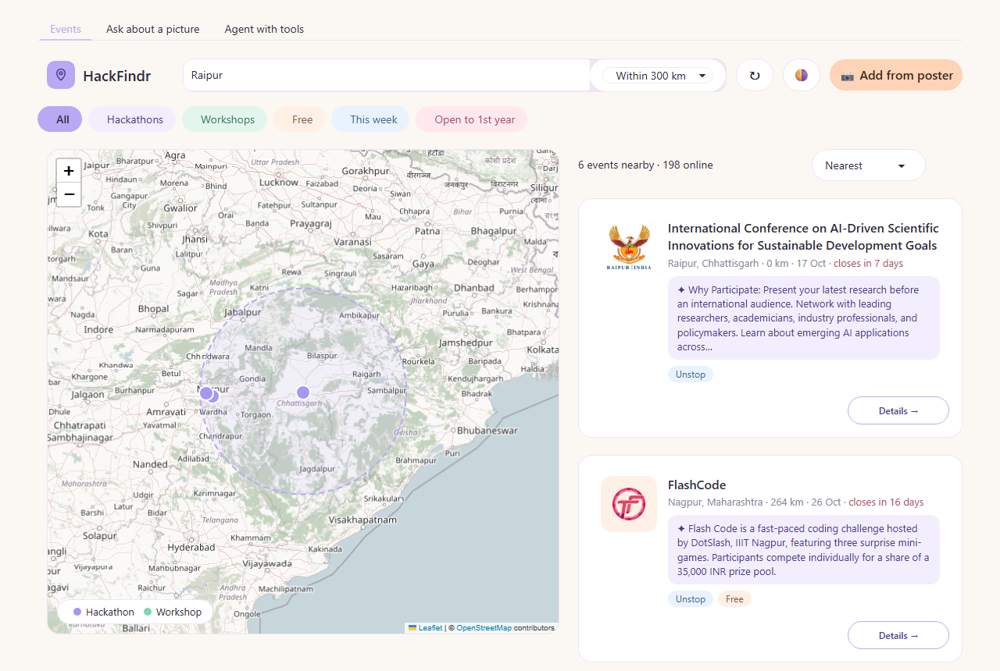

# HackFindr: built with Gemma 4

HackFindr finds upcoming student events (hackathons, ideathons, webinars, workshops, competitions, conferences)
from **Unstop** and **Devpost**, filters them by distance from your city, and shows them on a map.

It is built with **Gemma 4 (`gemma-4-26b-a4b-it`) through the Gemini API** (`google-genai`). Gemma:
- summarizes each Unstop event page into a short description, eligibility and requirements,
- reads a photo of an **event poster** and adds that event to the map (the demo highlight),
- powers an **agent with tools**: ask "hackathons within 200 km of Raipur".



## How to run
```
python -m venv .venv
.venv\Scripts\activate            # Mac/Linux: source .venv/bin/activate
pip install -r requirements.txt
copy .env.example .env            # then put your GEMINI_API_KEY in .env
python events.py                  # optional: fetch fresh events into events.json
python app_template/app.py        # open http://127.0.0.1:7860
```
If the internet or an API is down, the app uses the saved `events.json` (offline demo mode).

## How it works
| File | What it does |
|---|---|
| `events.py` | fetch Unstop + Devpost, normalize to one schema, geocode cities (cached in `geocache.json`), Gemma summaries (cached in `summary_cache.json`), save `events.json` |
| `harness/tools.py` | agent tools `search_events(city, radius_km, mode, event_type)` and `get_event_details(event_id)` |
| `app_template/app.py` | Gradio UI: **Events Map** tab (folium map, online-events table, poster upload) and **Agent with tools** tab |
| `gemma_client.py` | the starter's Gemma 4 helper (spacing, retries, cache) |
| `skills/hackfindr/SKILL.md` | agent skill describing how to use the tools |

Distance is the straight-line (haversine) distance from the city you type.
Geocoding uses OpenStreetMap Nominatim at most once per second.

Built on the Gemma 4 hackathon starter.

## License
MIT, see `LICENSE`.
